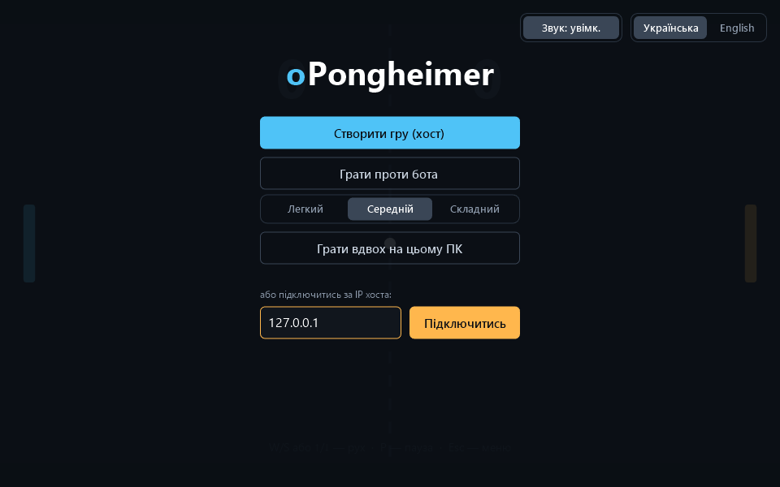
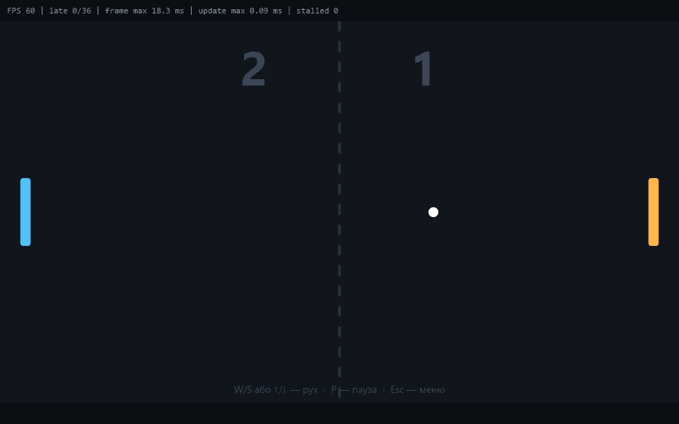
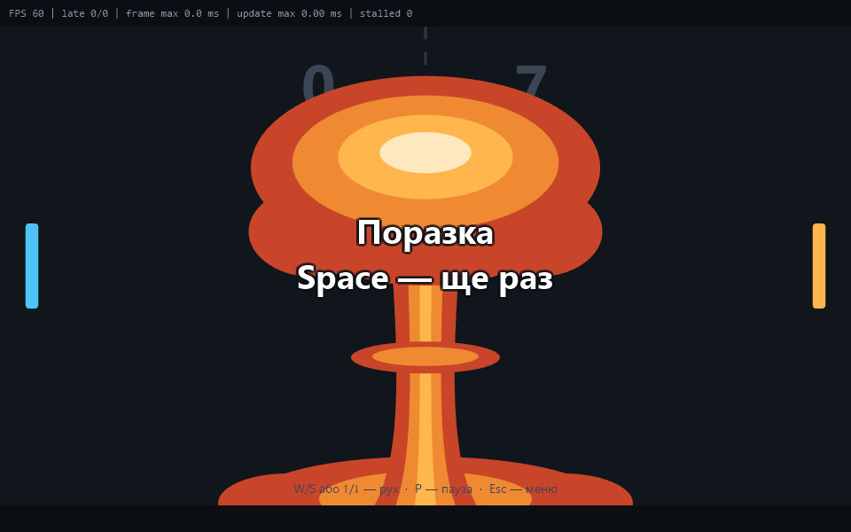
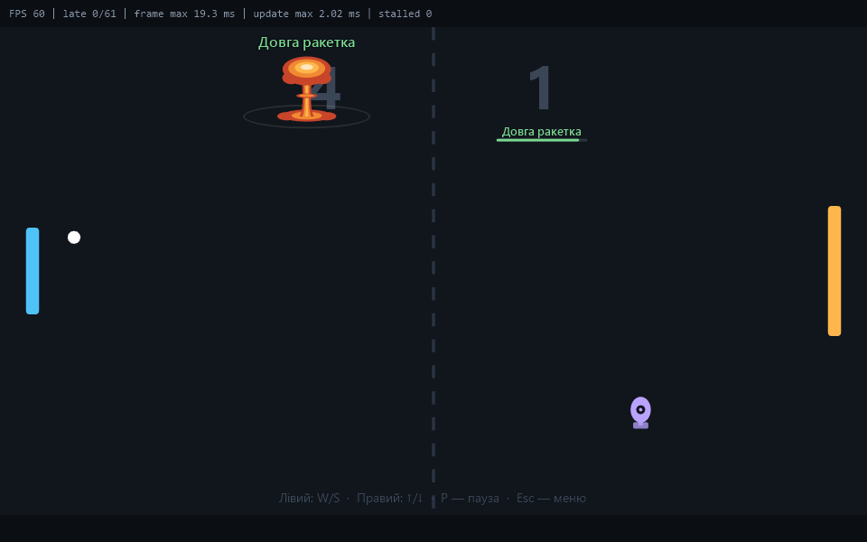

# oPongheimer

[Українська](README.md) · **English**

Two-player Pong for Windows: over the network, on one keyboard, or against a bot. A single exe you just run — nothing to install. And at the end of a match, a mushroom cloud awaits the loser.



| Game | Finale |
|---|---|
|  |  |

The screenshots show the Ukrainian interface; the language switch is in the top right corner of the menu.

## Features

- **Two modes** — classic Pong and nuclear, with bombs and bonuses.
- **Network play** — one player creates a game, the other joins by IP.
- **Two players on one PC** — left player on `W`/`S`, right player on the arrow keys.
- **Play against a bot** with three difficulty levels.
- **Pause**, shared between both players in a network game.
- **Ukrainian and English**, switchable on the fly.
- **Sounds** synthesized in memory — not a single audio file.
- **Steady 60 FPS** with vertical sync.

## How to play

Download `oPongheimer.exe` and run it. You need 64-bit Windows 10 or 11; there is no need to install .NET — it is already inside the exe.

### Controls

| Key | Action |
|---|---|
| `W` / `S` or `↑` / `↓` | move the paddle |
| `P` | pause |
| `Space` | rematch after the match ends |
| `Esc` | back to the menu |
| `F3` | smoothness counter |

In "two players on one PC" mode the keys are split: `W`/`S` for the left player, `↑`/`↓` for the right one.

A match is played to 7 points. The ball speeds up with every hit, and the bounce angle depends on which part of the paddle you hit it with.

### Nuclear mode



The mode is picked in the menu with the **"Classic / Nuclear"** switch and applies to bot, local and network games (in a network game the host picks it).

Bombs cross the field from the top and the bottom. Hit a bomb with the ball and it explodes, and whatever is inside goes to whoever touched the ball last. Whether that is good or bad is their problem. The bomb's colour hints at the contents:

| Colour | Contents | What it does |
|---|---|---|
| green | Long paddle | the paddle is one and a half times taller |
| green | Fast paddle | the paddle moves one and a half times faster |
| green | Shield | a wall behind the paddle saves you from one goal |
| green | Double point | your next goal counts as two |
| red | Short paddle | the paddle is almost half as tall |
| red | Slow paddle | the paddle moves slower |
| red | Freeze | the paddle freezes for a second |
| red | Inversion | up and down are swapped |
| purple | Big / small ball | the ball becomes much bigger or smaller |
| purple | Fast ball | the ball speeds up |
| purple | Normal speed | the ball returns to its starting speed |
| purple | Shockwave | the blast throws the ball in a random direction |

Timed effects last 8 seconds and are shown under the player's score; a goal clears all effects.

### Network play

1. The first player clicks **"Create game (host)"** — their IP appears in the window.
2. The second player enters that IP and clicks **"Join"**.

The host plays the left paddle, the client plays the right one.

What you need to connect:

- **The same network or a VPN.** To play over the internet, the host has to forward the port on their router.
- **TCP port 7777** must be allowed in the host's firewall. Windows asks about this by itself on first launch.
- **The same game version** on both sides. If the versions differ, the game will not connect and will say so.

## Building from source

You need the [.NET 10 SDK](https://dotnet.microsoft.com/download).

Build the ready-to-run exe:

```bash
dotnet publish src/Pongheimer.App/Pongheimer.App.csproj -c Release -o publish
```

The result is `publish/oPongheimer.exe`. All publish settings (single file, bundled .NET, compression) are already in the project file.

Run the tests:

```bash
dotnet test oPongheimer.slnx
```

## How it is organized

```
src/
  Pongheimer.Core/     game core, independent of graphics
    Game/              rules, physics, bot, deriving events from states
    Networking/        protocol and TCP connection
    Sessions/          matches: vs bot, local duel, host, client
  Pongheimer.App/      the MonoGame application
    Rendering/         drawing shapes and text, the field, the explosion
    Ui/                buttons, toggles, text field
    Menu/, Match/      the menu and the game screen
    Audio/             sound synthesis and playback
    Localization/      texts in both languages
tests/
  Pongheimer.Core.Tests/   core tests
```

A few decisions worth knowing before you change anything:

- **The core knows nothing about the screen.** The whole game — physics, bot, networking — lives in `Pongheimer.Core` and is covered by tests. The application only passes input in and draws the state, so the graphics layer can be replaced without touching the rules.
- **The host runs the simulation.** The client sends its paddle position and shows the state it receives from the host. The client moves its own paddle locally, so the controls never feel network latency.
- **The client moves the ball between packets by itself.** Host packets and client frames do not line up in time, so without this the ball would stutter even on a perfect network.
- **The network is not trusted.** Every incoming packet is validated; a connection starts with an exchange of protocol versions.
- **Texts are classes, not resource files.** Each language is a subclass of `Texts`, so a forgotten translation is a compile error.

If you change the network packet format, bump `Protocol.Version` in `src/Pongheimer.Core/Networking/Protocol.cs`: players on different versions will then see a clear message instead of strange behaviour.

Code comments are written in Ukrainian.

## Diagnostics

The game writes its log and keeps its settings here:

```
%LocalAppData%\oPongheimer\
```

`F3` in the game shows the smoothness counter: frame rate, number of late frames, and logic update time.

Service launch options:

| Option | What it does |
|---|---|
| `--perf` | shows the smoothness counter right away and writes it to the log |
| `--autostart=bot\|duel\|host\|join` | starts a mode right away, with no clicks in the menu |
| `--screenshot=2,5.5` | saves screenshots at the given seconds into the `screenshots` folder |
| `--mode=classic\|nuclear` | game mode for this launch instead of the one picked in the menu |

## Tech

C#, .NET 10, [MonoGame](https://monogame.net/) 3.8 (DirectX), xUnit.
